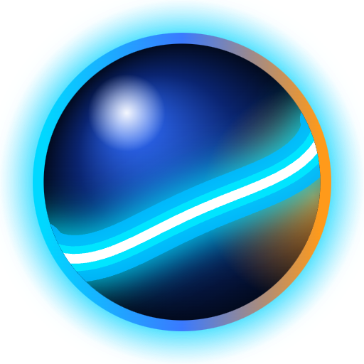
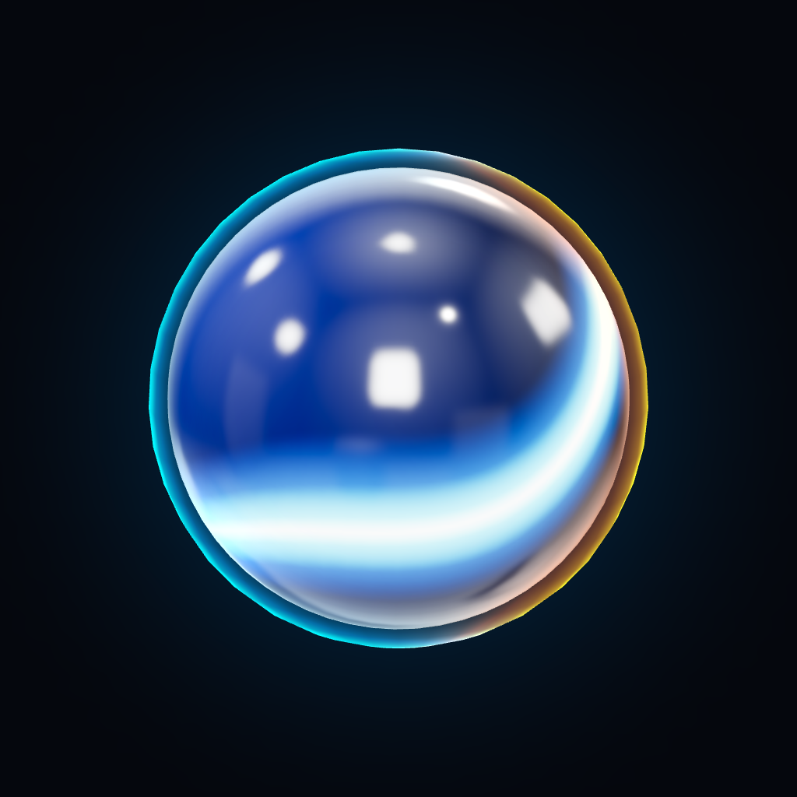

# Cnmbuck Studios brand kit

The one home of the **Cnmbuck Orb**, Cnmbuck Studios' signature ball, and the logo assets that go with it.
Every Cnmbuck game uses the Orb from this repo, **unchanged**.

The Orb here is the definitive version: it is the one shipped in Gravitor
([cnmbuck1/gravity-shift](https://github.com/cnmbuck1/gravity-shift), `src/brand/cnmbuck-orb.ts`).

| Flat icon | In 3D (with rim glow) | Gravitor wordmark |
|---|---|---|
|  |  |  |

## The rule: use it unchanged

1. **Copy `orb/cnmbuck-orb.ts` into the game byte for byte.** Do not edit, reformat, re-lint, translate
   or "tidy" it. Put it at `src/brand/cnmbuck-orb.ts` by convention.
2. **Do not change any colour, number, shader or texture.** No near matches, no "slightly brighter for this
   game". Size and placement are the game's choice; the look is not.
3. **Check the copy** with `sha256sum -c` against `orb/cnmbuck-orb.ts.sha256` (see below).
4. If the Orb itself must change, change it **here first** (a PR to this repo that Chris approves), then
   copy the new file to every game.
5. A game may wrap the Orb (its own ball class, physics, unlock rules), but the wrapper calls the kit; it
   never re-implements or patches it.

The only dependency is `three` (tested with 0.187). It has no other imports.

## What's in the repo

```
orb/
  cnmbuck-orb.ts          The Orb. Copy this file unchanged. (Everything below is optional.)
  cnmbuck-orb.ts.sha256   Checksum of the canonical file.
  orb.json                The canonical numbers as data, for engines that can't run the .ts (reference only).
examples/
  three-usage.ts          How Gravitor puts the Orb in a three.js scene (renderer settings, ball, glow).
  orb-wordmark.ts         A game name with the Orb as its O (Gravitor's GRAVIT(O)R launch wordmark).
  gravitor-icons.ts       Gravitor's four app icon concepts; "maze" (Neon maze) is the shipped icon.
assets/
  orb/                    PNGs of the Orb: 1024/512/256 with halo, 1024 without halo, a 3D render.
  gravitor/               Gravitor's shipped app icon (Neon maze), launch image and transparent wordmark.
tools/
  render.mjs              Re-draws assets/orb and the wordmark PNG from the kit (npm run render).
```

## Using it in a game

### Copy and verify

```sh
mkdir -p src/brand
curl -sSfL https://raw.githubusercontent.com/cnmbuck1/cnmbuckstudios-brand/main/orb/cnmbuck-orb.ts -o src/brand/cnmbuck-orb.ts
curl -sSfL https://raw.githubusercontent.com/cnmbuck1/cnmbuckstudios-brand/main/orb/cnmbuck-orb.ts.sha256 -o /tmp/orb.sha256
(cd src/brand && sha256sum -c /tmp/orb.sha256)   # must print: cnmbuck-orb.ts: OK
```

(Or clone this repo and `cp orb/cnmbuck-orb.ts`.)

### The ball in three.js

```ts
import * as THREE from 'three';
import { createOrbMaterial, OrbFx } from './brand/cnmbuck-orb';

renderer.outputColorSpace = THREE.SRGBColorSpace;          // the Orb was tuned under these
renderer.toneMapping = THREE.ACESFilmicToneMapping;
renderer.toneMappingExposure = 1.05;

const RADIUS = 0.5;
const ball = new THREE.Mesh(new THREE.SphereGeometry(RADIUS, 48, 32), createOrbMaterial());
scene.add(ball);

const fx = new OrbFx(RADIUS);             // { groundGlow: false } when "down" isn't always -Y
scene.add(fx.group);
fx.on = true;                             // while the Orb is the ball in play

// every frame, after moving the ball:
fx.update(ball.position, groundY /* or null */, speed > 0.4, ball.visible, dt, camera, renderer);
```

`createOrbMaterial()` builds its textures once and shares the material. `OrbFx` needs a page (it draws
to canvases), so create it after the DOM exists. See `examples/three-usage.ts` for the full pattern.

### Flat (menus, icons, 2D games)

```ts
import { drawOrbIcon } from './brand/cnmbuck-orb';
drawOrbIcon(ctx, size, x, y);             // fills a size×size square; the ball is ~0.76 of it
drawOrbIcon(ctx, size, x, y, spin);       // spin (radians) turns the band, for a rolling 2D ball
drawOrbIcon(ctx, size, x, y, 0, false);   // no halo
```

In HTML, draw it into a `<canvas>` sized a bit larger than a letter. Gravitor's title uses
`.logo-orb { width: 1.12em; height: 1.12em; margin: -0.17em -0.1em; }` with a 240×240 canvas.

### Static images

Where code can't run (store pages, social, press), use the PNGs in `assets/orb/`. Don't recolour or
redraw them; regenerate with `npm run render` if the kit ever changes.

## Canonical parameters

All of these live in `orb/cnmbuck-orb.ts`; `orb/orb.json` repeats them as data.

**Colours** (`ORB`)

| Name | Hex | Where |
|---|---|---|
| glassDeep | `#020818` | glass at its darkest (bottom) |
| glass | `#0c3486` | glass lit from above |
| bandOuter | `#0a8cff` | band's soft outer glow |
| band | `#00e5ff` | the neon band |
| bandCore | `#f0feff` | band's white-hot core |
| rimBlue | `#00d8ff` | rim light, screen-left |
| rimOrange | `#ff9a1a` | rim light, screen-right |

**Ball material** (`createOrbMaterial`): `MeshPhysicalMaterial`, roughness 0.08, metalness 0,
clearcoat 1, clearcoatRoughness 0.08, emissive white × emissiveIntensity 2.6 through a glow map.
Colour map and glow map are 512×256 sphere maps (SphereGeometry UV layout), sRGB, anisotropy 4.

**Neon band**: a tilted ring, `s = 0.42·y + 0.88·x − 0.12·sin(3·atan2(y, z))` on the unit sphere.
Colour map: glass gradient `0.45 + 0.55·y + 0.12·wobble`, then outer glow width 0.34 (×0.7), band width
0.16, core width 0.06. Glow map: dark `#000208`→`#020c2e`, outer 0.36, band 0.18, white core 0.06.

**Extras** (`OrbFx`)
- Rim glow: sphere at 1.08 × radius, fresnel power 2.4, blue→orange by `smoothstep(-0.2, 0.6, normal.x)`,
  strength 2.4 (+1.0 on the warm side), additive.
- Pulse: `0.85 + 0.15·sin(3t)` on rim, halo and ground glow.
- Halo: sprite 4.2 × radius, `rgba(0,220,255,0.9)` → `rgba(0,150,255,0.35)`, opacity 0.5 × pulse.
- Ground glow (optional, default on): 6 × radius plane at 0.07 × radius above ground, fades out as the
  ball lifts over 5 radii, max opacity 0.8.
- Light trail: 26 points, 0.45 s life, a point each 0.35 × radius travelled, size 2.1 × radius,
  orange (old) → blue (fresh), drawn as normal (not additive) colour so it shows on pale ground.

**Flat icon** (`drawOrbIcon`): ball radius 0.38 × size; halo 0.9r→1.32r `rgba(0,200,255,0.55)`;
rim ring +0.03 × size, gradient `#00d8ff` → `#3a7aff` → `#ff9a1a`; body radial `#2a62e8` → `#0a2470` →
`#020a1e`; warm glow `rgba(255,150,30,0.8)` on the right; band at −0.42 rad (+spin), drawn three times:
`rgba(0,170,255,0.9)` 0.34r, `#00e5ff` 0.18r, `#ffffff` 0.07r; highlight top-left.

## Gravitor assets

- `assets/gravitor/app-icon-neon-maze-1024.png`: the shipped iOS app icon (concept B "Neon maze", chosen
  2026-11-16), opaque RGB as the App Store requires. Drawn by `examples/gravitor-icons.ts` (`ICONS.maze`).
- `assets/gravitor/launch-wordmark-2732.png`: the shipped launch image, GRAVIT(O)R centred on `#05070d`.
- `assets/gravitor/wordmark-transparent.png`: the same wordmark on transparent, 2400×600.

These belong to Gravitor; other games make their own icon with the Orb as the hero, using
`drawOrbIcon` and, if their name has an O, `drawOrbWordmark` from `examples/orb-wordmark.ts`.

## Regenerating the PNGs

```sh
npm install
npm run render      # needs Playwright's Chromium
npm run typecheck
```
